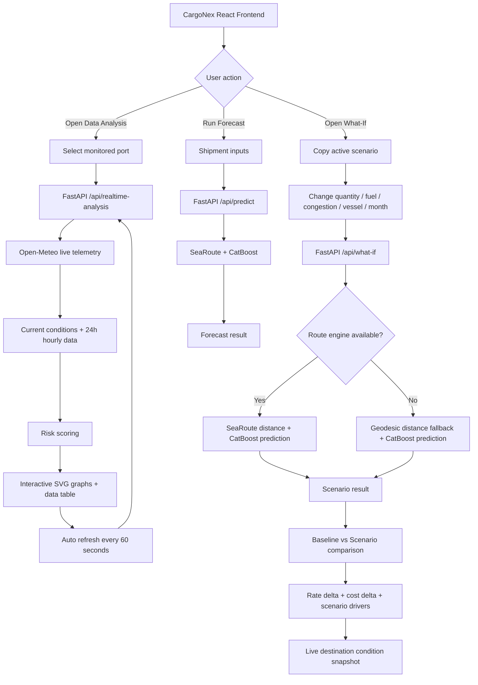

# CargoNex — Real-Time Data Analysis + What-If Flowchart

## Working principle

1. **Data Analysis** reads live port telemetry from Open-Meteo and converts the hourly feed into graph-ready values.
2. **Forecasting** keeps the existing shipment form and CatBoost model unchanged.
3. **What-If** starts from the active forecast inputs, changes only the selected variables, and calls the same backend prediction stack.
4. **Comparison** reports the difference from the baseline rather than replacing the original result.
5. **Resilience** prevents optional live-data or SeaRoute failures from taking down the interface.
